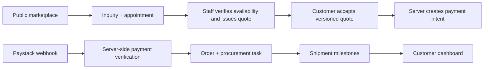

# Architecture decision

DirectBelgium should be a modular Next.js monolith backed by a dedicated Supabase project. The public UI, authenticated customer portal and staff operations surface share domain services; only privileged server code handles price acceptance, payment verification, procurement and shipment updates.

## Security boundaries

- Browser clients never receive service-role credentials, supplier detail, internal cost, margin or payment verification authority.
- Product availability is language such as `AVAILABLE_FOR_INQUIRY`, not a guaranteed supplier hold.
- Quotes use immutable version snapshots and expiry timestamps. Payment is created only from an accepted, unexpired quote on the server.
- A signed webhook plus provider transaction lookup is required before a payment is marked verified. All webhook processing is idempotent.
- RLS grants customers only their own records. Staff actions must additionally pass server-side role authorization; RLS is defence in depth.

## Required environment values

`NEXT_PUBLIC_SUPABASE_URL`, `NEXT_PUBLIC_SUPABASE_PUBLISHABLE_KEY`, `SUPABASE_SERVICE_ROLE_KEY`, `PAYSTACK_SECRET_KEY`, `PAYSTACK_WEBHOOK_SECRET`, `RESEND_API_KEY`, `EMAIL_FROM`, `WHATSAPP_BUSINESS_NUMBER`, `NEXT_PUBLIC_APP_URL`.

Use a dedicated DirectBelgium Supabase project. Do not apply this commerce schema to the existing Outlyride backend.
